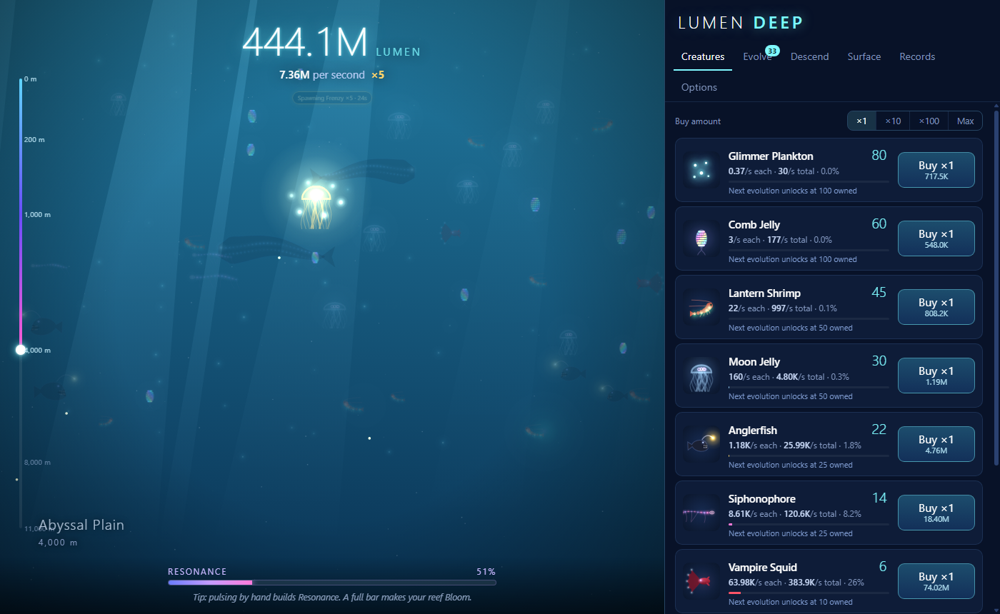
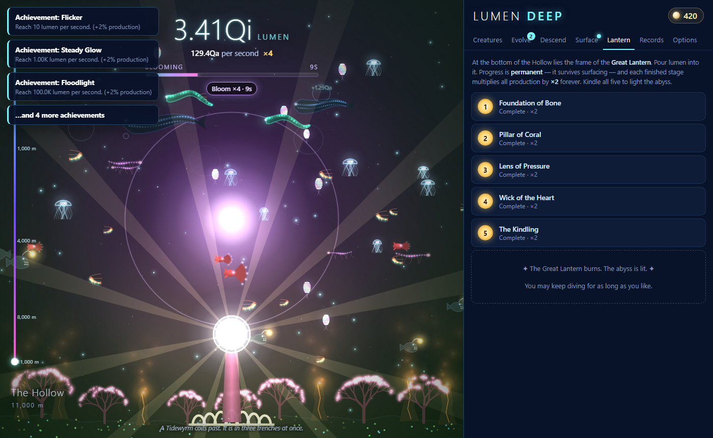

# Lumen Deep

An original bioluminescent idle/incremental game. Grow a glowing reef, sink through six ocean zones,
and kindle the Great Lantern at the bottom of the world.

**Play online:** https://ale4224.github.io/lumen-deep/

Or open `index.html` locally in any modern browser. No build step, no server, no dependencies.

## How it plays
- **Pulse** – click the water for lumen. Hand pulses fill **Resonance**; a full bar triggers a **Bloom** (production ×3+).
- **Creatures** – 12 procedurally-drawn species that swim on screen as you buy them.
- **Evolve** – ~150 upgrades: per-species evolutions, Food Web synergies (predators feed on the tier below),
  biochemistry multipliers, pulse, resonance/echo and Moon-jelly upgrades.
- **Descend** – 6 depth zones; each one is ×1.25 production, unlocks 2 creatures and changes the scene.
- **Moon Pearl Jellies** – golden drifting event creatures; click them for a lumen cache, ×5 frenzy, ×10 pulses or a free Bloom.
- **Surface** (prestige) – trade a dive for Pearls (cube root of lumen earned). Unspent pearls give +2% each,
  or spend them on 9 permanent Relics.
- **The Great Lantern** – a permanent 5-stage endgame project fed with lumen from the Hollow. Each stage ×2 forever; finishing it wins the game.
- 74 achievements (+2% each), offline progress, autosave, export/import, sound, number formats.

## Files
- `js/core.js` – all game rules and data (pure, no DOM; also loadable in Node).
- `js/render.js` – canvas deep-sea renderer (all art is procedural).
- `js/game.js` – UI, input, loop, save/load. `js/audio.js` – synthesized WebAudio sfx.
- `tools/sim.js` – balance simulator: `node tools/sim.js [hours] [clicksPerSec] [moonCatchRate] [double|rate]`.
- `tools/cdp.js` + `tools/demo.html` – headless Chrome screenshot harness with preset saves (`mid`, `late`, `won`).

Sim pacing (greedy bot): active player (3 clicks/s) ≈ first surfacing at 40 min, the Hollow in run 2,
victory ≈ 5 h; fully idle ≈ 18 h.
